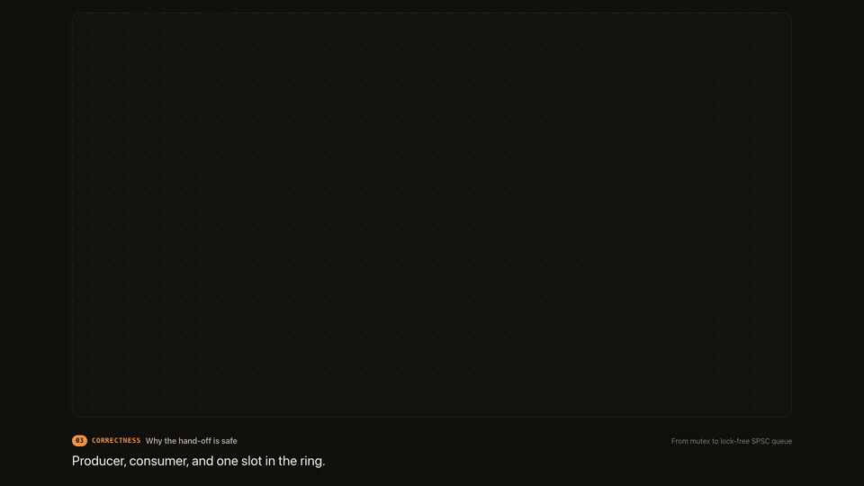
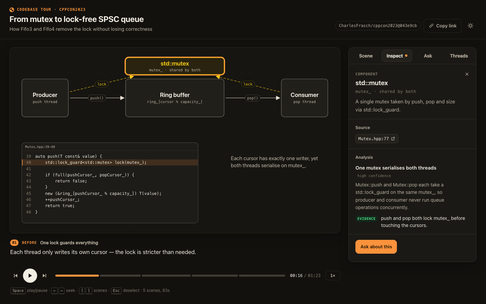
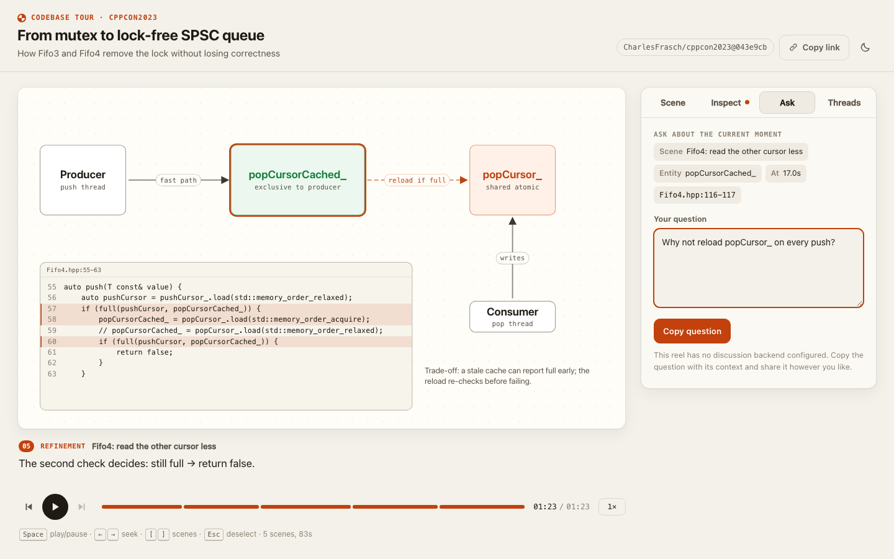

# mutoscope

**Turn a pull request, a codebase, a concept or an incident into an interactive, discussable animated reel.**

A mutoscope was the 1890s peep-show machine where *the viewer* turned the crank — faster, slower, stop on any frame. Same idea here: an agent writes a short storyboard, and the reel is a single HTML file the viewer can play, pause, scrub, click into, and ask questions about. The same reel exports to MP4.



- **Recipe-driven.** A recipe says how to turn one kind of source into a reel. Built-ins: `pr`, `codebase-tour`, `concept`, `incident` — add your own as one markdown file.
- **Agent-agnostic.** The skill follows the open [Agent Skills](https://agentskills.io) layout (`SKILL.md` + resources). All deterministic work is a plain CLI, so Claude Code, Codex, Gemini CLI, Cursor or any agent that can run a shell command can drive it.
- **Data, not code.** Agents write validated JSON (scenes, entities, timeline actions); a fixed renderer draws it. No generated JavaScript ever runs in a reel.
- **Honest by construction.** Every claim is tagged `evidence` (must cite a source ref) or `inference`. Code refs are pinned to commit SHAs, and `validate --repo-root` rejects snippets that don't match the pinned file.
- **Collaborative without a backend.** Viewers ask questions anchored to scene + entity + timestamp; they land as GitHub Discussions. The author's local agent drafts grounded answers, and nothing is posted without explicit approval.
- **Portable.** One self-contained `index.html` with a strict CSP (no network access at all). Host it on GitHub Pages, any static host, or open it from disk.

| Inspect anything | Ask about the exact moment |
|---|---|
|  |  |

## How it works

```
source ──recipe──▶ analysis.json ──▶ scenes.json ──validate──▶ snapshot ──▶ preview ──▶ publish (GitHub Pages)
                     (claims)        (storyboard)                    │                      │
                                                                 export → MP4     viewer asks (GitHub Discussion)
                                                                                           │
                                         author approves ◀── agent drafts ◀── inbox / question
                                                │
                                              reply ──▶ sync ──▶ thread shows inside the reel
```

The renderer is a pure function `sceneStateAt(scene, t)`: seeking, playback and video export always produce the same frame, which is also what makes reels testable.

## Install

Requires Node.js ≥ 22. GitHub features need an authenticated [`gh`](https://cli.github.com); snapshots and video export need Playwright Chromium (and `ffmpeg` for MP4).

```bash
git clone https://github.com/voidforall/mutoscope && cd mutoscope
npm install && npx playwright install chromium
npm run install-skill          # builds, then links skills/mutoscope into ~/.agents/skills (and ~/.claude/skills if present)
node scripts/install-skill.mjs --target ~/.codex/skills   # or any other agent's skills directory
```

Then ask your agent for a walkthrough of a PR, a tour of a module, or an explainer — or call the CLI directly:

```bash
alias mutoscope="node $PWD/skills/mutoscope/runtime/cli.mjs"
mutoscope help
```

## Try the example

`examples/spsc-evolution` walks through the progression from a mutex-guarded queue to a lock-free SPSC ring buffer in [CharlesFrasch/cppcon2023](https://github.com/CharlesFrasch/cppcon2023), pinned to a commit.

```bash
mutoscope validate examples/spsc-evolution
mutoscope preview  examples/spsc-evolution          # http://127.0.0.1:4870/
mutoscope export   examples/spsc-evolution --out spsc.mp4
```

## CLI

| Command | What it does |
|---|---|
| `recipes` | List recipes (project `.mutoscope/recipes/`, user `~/.mutoscope/recipes/`, built-in) |
| `init <dir> --recipe <name> --title <t>` | Create a reel directory with a manifest |
| `ingest pr <url> --reel <dir>` / `ingest git <base> <head> --reel <dir>` | Fetch diff + metadata, pin SHAs |
| `validate <dir> [--repo-root <checkout>]` | Schema, cross-references, layout overlaps, pacing, and (with a checkout) source refs + snippet fidelity |
| `build <dir> [--out <dir>]` / `preview <dir>` | Static site / local server |
| `snapshot <dir> [--at end\|mid\|both]` | PNG per scene for visual review |
| `export <dir> [--fps 30]` | MP4 via headless Chromium + ffmpeg |
| `collab setup <dir> --repo o/r` | Route viewer questions to a GitHub Discussions category |
| `publish <dir> [--yes]` | Dry-run plan + safety scan; pushes to GitHub Pages only with `--yes` |
| `inbox`, `question <n>`, `reply <n> --body-file f [--yes]`, `sync` | The question → answer loop |

## The reel format

A reel directory holds `manifest.json`, `scenes.json`, and optionally `analysis.json`, `rationale.md` (author-approved design rationale, the only "memory" answers may draw on) and `threads.json` (synced discussions). Schemas live in [`src/schema`](src/schema) (Zod) and are versioned (`schemaVersion: "0.1.0"`); the authoring guide is [`skills/mutoscope/references/storyboard.md`](skills/mutoscope/references/storyboard.md).

Entities: `component`, `edge`, `code-block`, `diff-panel`, `label`, `group` on a 12 × 8 grid. Actions: `appear`, `disappear`, `connect`, `disconnect`, `highlight`, `dim`, `restore`, `move`, `replace`, `focus`.

## Security model

- Reels contain data only; the page's CSP allows exactly the bundled player script (by hash) and no network requests.
- Ingested text, discussions and questions are untrusted input — the skill instructs agents to treat them as data, and the CLI never executes repository code.
- `publish` blocks secrets, references to sensitive files, and private source going to public Pages; it is a dry run without `--yes`.
- `reply` is a preview without `--yes`; every posted answer carries a visible AI-assisted notice and the approver's handle.
- No tokens are embedded in reels; viewers open GitHub's own "new discussion" page with the context prefilled.

## Development

```bash
npm run typecheck && npm test        # unit tests (vitest)
npm run build && npm run test:e2e    # player end-to-end tests (Playwright)
npm run check                        # all of the above
```

Layout: `src/schema` (format), `src/core` (pure engine: timeline, geometry, validation, deep links, discussion codec), `src/player` (React player), `src/cli` (commands), `src/adapters/github`, `skills/mutoscope` (the skill: `SKILL.md`, recipes, references, built runtime). Design notes: [`docs/design.md`](docs/design.md).

## License

MIT
