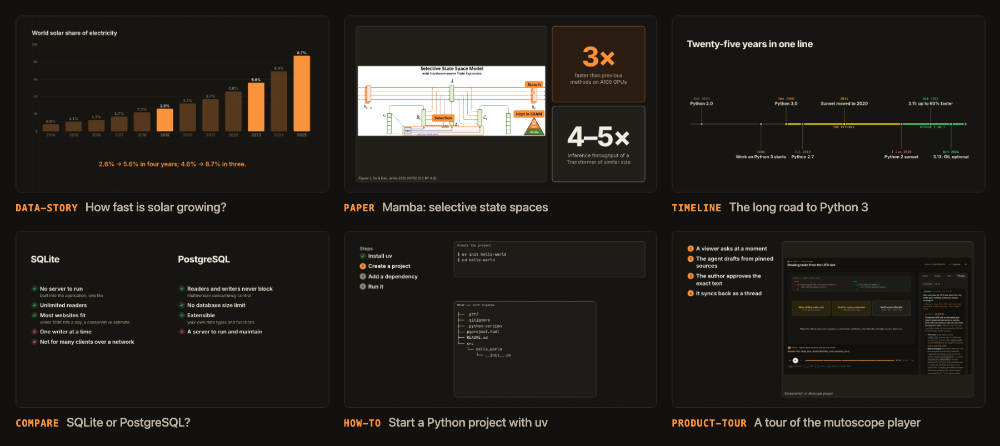

# mutoscope

**Turn a pull request, a codebase, an article, a paper, a dataset, a how-to, a comparison or a history into an interactive, discussable animated reel.**

A mutoscope was the 1890s peep-show machine where *the viewer* turned the crank — faster, slower, stop on any frame. Same idea here: an agent writes a short storyboard, and the reel is a single HTML file the viewer can play, pause, scrub, click into, and ask questions about. The same reel exports to MP4.


- **Recipe-driven.** A recipe says how to turn one kind of source into a reel. Built-ins: `pr`, `codebase-tour`, `article`, `paper`, `data-story`, `concept`, `how-to`, `compare`, `timeline`, `product-tour`, `news-brief`, `incident` — add your own as one markdown file.
- **More than diagrams.** Scenes mix boxes and arrows with display headlines, counting stats, bar/column/line charts, time axes, annotated images, tables and lists, each building in on cue.
- **Agent-agnostic.** The skill follows the open [Agent Skills](https://agentskills.io) layout (`SKILL.md` + resources). All deterministic work is a plain CLI, so Claude Code, Codex, Gemini CLI, Cursor or any agent that can run a shell command can drive it.
- **Data, not code.** Agents write validated JSON (scenes, entities, timeline actions); a fixed renderer draws it. No generated JavaScript ever runs in a reel.
- **Honest by construction.** Every claim is tagged `evidence` (must cite a source ref) or `inference`. Charts and stats can be bound to a pinned dataset, and `validate` recomputes every number. Code refs are pinned to commit SHAs, and `validate --repo-root` rejects snippets that don't match the pinned file. Web pages are pinned as snapshots (`ingest url`), and `validate` rejects quotes that aren't word for word on the page and `#anchors` that don't exist.
- **Ask your own agent while you watch.** `mutoscope watch` opens the reel with an *Ask your agent* panel. Pause anywhere, click an element, ask, and the question reaches the agent in your terminal with that exact moment attached (plus a rendered frame). The answer appears beside the reel, with links that jump the player to what it explains.
- **Collaborative without a backend.** Published reels take questions from other viewers, anchored to scene + entity + timestamp; they land as GitHub Discussions. The author's local agent drafts grounded answers, and nothing is posted without explicit approval.
- **Portable.** One self-contained `index.html` with a strict CSP (no network access at all). Host it on GitHub Pages, any static host, or open it from disk.

| Inspect anything | Ask about the exact moment |
|---|---|
|  |  |

## How it works

```
source ──recipe──▶ analysis.json ──▶ scenes.json ──validate──▶ snapshot ──▶ preview ──▶ publish (GitHub Pages)
                     (claims)        (storyboard)                    │                      │
                                                                 export → MP4     viewer asks (GitHub Discussion)
                                                                                           │
                                         author approves ◀── agent drafts ◀── inbox / question
                                                │
                                              reply ──▶ sync ──▶ thread shows inside the reel
```

The renderer is a pure function `sceneStateAt(scene, t)`: seeking, playback and video export always produce the same frame, which is also what makes reels testable.

## Install

```bash
npx skills add voidforall/mutoscope
```

That installs the skill for whichever agents you pick (Claude Code, Codex, Cursor, Gemini CLI, OpenCode, …). Add `-g` to install it for all your projects. The CLI ships prebuilt inside the skill folder, so the only requirement is **Node.js ≥ 22**. No `npm install` and no build step.

Then ask your agent for a walkthrough of a PR, a tour of a module, or an explainer.

Optional extras, only needed for some features:

| For | Needs |
|---|---|
| PR ingest, discussions, publishing to Pages | an authenticated [`gh`](https://cli.github.com) |
| `snapshot`, MP4 `export`, frame images in live sessions | `mutoscope install-browser` (one-time: Playwright + Chromium into `~/.mutoscope/deps`) |
| MP4 `export` | `ffmpeg` on PATH |

To call the CLI yourself: `alias mutoscope="node <skill-dir>/runtime/cli.mjs"`, then `mutoscope help`.

## Examples



| Reel | Recipe | What it shows |
|---|---|---|
| [`examples/solar-share`](examples/solar-share) | data-story | How fast solar is growing, from Our World in Data. Every chart value and stat is recomputed from the pinned CSV. |
| [`examples/mamba-paper`](examples/mamba-paper) | paper | The Mamba paper (arXiv 2312.00752): the idea, the method, results redrawn from its tables, its own figure with callouts, and its limits. |
| [`examples/python-3-timeline`](examples/python-3-timeline) | timeline | Eleven years of Python 2 and 3 side by side, from python.org's own release list and sunset notice. |
| [`examples/sqlite-vs-postgres`](examples/sqlite-vs-postgres) | compare | SQLite or PostgreSQL for a web app, each side argued from its own docs, ending in a scoped verdict. |
| [`examples/uv-quickstart`](examples/uv-quickstart) | how-to | Start a Python project with uv: every command quoted from the docs, with a step tracker. |
| [`examples/mutoscope-tour`](examples/mutoscope-tour) | product-tour | The mutoscope player itself, from real screenshots with callouts. |
| [`examples/spsc-evolution`](examples/spsc-evolution) | codebase-tour | From a mutex-guarded queue to a lock-free SPSC ring buffer in [CharlesFrasch/cppcon2023](https://github.com/CharlesFrasch/cppcon2023), pinned to a commit. |

From a clone of this repo:

```bash
mutoscope watch    examples/solar-share             # watch it and ask your agent about any moment
mutoscope validate examples/solar-share             # quotes and every number re-checked
mutoscope preview  examples/mamba-paper             # http://127.0.0.1:4870/
mutoscope export   examples/python-3-timeline --out python.mp4
```

`examples/spsc-evolution` checks its code against the pinned commit: `mutoscope validate examples/spsc-evolution --repo-root <a clone of cppcon2023>`.

## Watch with your agent

```bash
mutoscope watch examples/spsc-evolution     # opens http://127.0.0.1:4880/s/<session>/
mutoscope poll  examples/spsc-evolution     # (your agent runs this) waits for your question
```

The pattern is the same as [lavish-axi](https://github.com/kunchenguid/lavish-axi). A background server on loopback holds the session. The agent long-polls it with `poll`, and `poll --reply-file answer.md` delivers an answer and waits for the next question. Questions survive agent restarts until they're answered. Editing the reel files reloads the open tab in place (same moment, same conversation), so "this caption is wrong" can be fixed on the spot. Live answers never leave the machine.

The session page differs from a published reel in one way: its CSP adds `connect-src 'self'`. The server only accepts requests addressed to `127.0.0.1`/`localhost` (which blocks DNS rebinding). Browser writes need the page's per-session token and same-origin `Origin`, and agent calls need a separate token stored `0600` in `~/.mutoscope/live/`.

## CLI

| Command | What it does |
|---|---|
| `recipes` | List recipes (project `.mutoscope/recipes/`, user `~/.mutoscope/recipes/`, built-in) |
| `init <dir> --recipe <name> --title <t>` | Create a reel directory with a manifest |
| `ingest pr <url> --reel <dir>` / `ingest git <base> <head> --reel <dir>` | Fetch diff + metadata, pin SHAs |
| `ingest url <https-url> --reel <dir>` | Snapshot a web page (text, anchors, hash) so quotes can be checked |
| `ingest data <file\|https-url> --reel <dir>` | Pin a CSV/TSV/JSON dataset and print its columns; bound charts and stats are recomputed from it |
| `ingest image <file\|https-url> --reel <dir>` | Copy an image into `assets/` (metadata stripped), remembering where a download came from |
| `validate <dir> [--repo-root <checkout>]` | Schema, cross-references, layout, text fit, pacing, quotes against pinned pages, numbers against pinned datasets, and (with a checkout) source refs + snippet fidelity |
| `build <dir> [--out <dir>]` / `preview <dir>` | Static site / local server |
| `snapshot <dir> [--at end\|mid\|both]` | PNG per scene for visual review |
| `watch <dir>`, `poll <dir> [--reply-file f]`, `end <dir>`, `sessions` | Live session: watch in the browser, ask your local agent |
| `export <dir> [--fps 30]` | MP4 via headless Chromium + ffmpeg |
| `collab setup <dir> --repo o/r` | Route viewer questions to a GitHub Discussions category |
| `publish <dir> [--yes]` | Dry-run plan + safety scan; pushes to GitHub Pages only with `--yes` |
| `inbox`, `question <n>`, `reply <n> --body-file f [--yes]`, `sync` | The question → answer loop |

## The reel format

A reel directory holds `manifest.json`, `scenes.json`, and optionally `analysis.json`, `rationale.md` (author-approved design rationale, the only "memory" answers may draw on) and `threads.json` (synced discussions). Schemas live in [`src/schema`](src/schema) (Zod) and are versioned (`schemaVersion: "0.1.0"`); the authoring guide is [`skills/mutoscope/references/storyboard.md`](skills/mutoscope/references/storyboard.md).

Entities on a 12 × 8 grid (or named regions such as `left`, `heading`, `right-third`): diagrams (`component`, `edge`, `group`), code and words (`code-block`, `diff-panel`, `label`, `quote`, `headline`), data and media (`stat`, `chart`, `time-axis`, `table`, `list`, `image`). Actions: `appear`, `disappear`, `connect`, `disconnect`, `highlight`, `dim`, `restore`, `move`, `replace`, `focus`; entities with parts (words, bars, events, rows, items, callouts) build them in during `appear`. Images live in the reel's `assets/` folder and are embedded, so a reel still makes no network requests.

## Security model

- Reels contain data only; the page's CSP allows exactly the bundled player script (by hash) and no network requests.
- Ingested text, discussions and questions are untrusted input — the skill instructs agents to treat them as data, and the CLI never executes repository code.
- `publish` blocks secrets, references to sensitive files, and private source going to public Pages; it is a dry run without `--yes`.
- `reply` is a preview without `--yes`; every posted answer carries a visible AI-assisted notice and the approver's handle.
- No tokens are embedded in reels; viewers open GitHub's own "new discussion" page with the context prefilled.

## Development

```bash
git clone https://github.com/voidforall/mutoscope && cd mutoscope
npm install && npx playwright install chromium
npm run install-skill                # build, then symlink skills/mutoscope into ~/.agents/skills (and ~/.claude/skills)
npm run typecheck && npm test        # unit tests (vitest)
npm run build && npm run test:e2e    # player end-to-end tests (Playwright)
npm run check                        # all of the above
```

The built runtime (`skills/mutoscope/runtime/`) is committed so the skill installs without a build. Run `npm run build` and commit the result with any source change; CI fails if they drift.

Layout: `src/schema` (format), `src/core` (pure engine: timeline, geometry, validation, deep links, discussion codec), `src/player` (React player), `src/cli` (commands), `src/adapters/github`, `skills/mutoscope` (the skill: `SKILL.md`, recipes, references, built runtime). Design notes: [`docs/design.md`](docs/design.md).

## License

MIT
